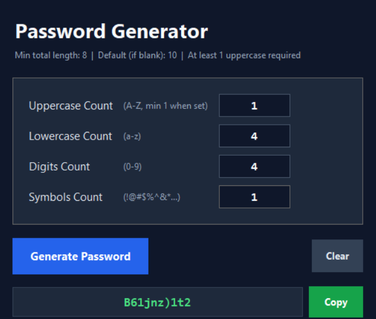

# Secure Password Generator

A desktop password generator built with Python (`tkinter` and `secrets`) to help users move away from predictable passwords—such as names or birthdates—and generate strong, random passwords instead.

## Preview



## Features

- Uses `secrets` and `secrets.SystemRandom().shuffle` instead of `random` for stronger security.
- Lets the user specify counts for **Uppercase**, **Lowercase**, **Digits**, and **Symbols**.
- Generates a default **10-character** password if all fields are left blank.
- Enforces a minimum total length of **8** characters and at least **1 uppercase** character when custom counts are entered.
- Includes a **Copy** button to copy the generated password with one click.
- Requires no external packages (uses Python's built-in standard library only).

## How to Run

1. Make sure Python 3 is installed.
2. Place `password_generator.py` and `screenshot.png` in the same project folder.
3. Run the script:

```bash
python password_generator.py

Note
Generated passwords are created locally on your machine and are not stored or sent anywhere.

Author
GitHub: @fahedgharaibeh